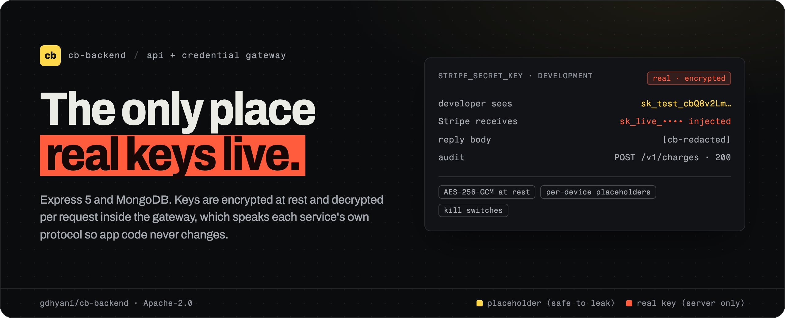
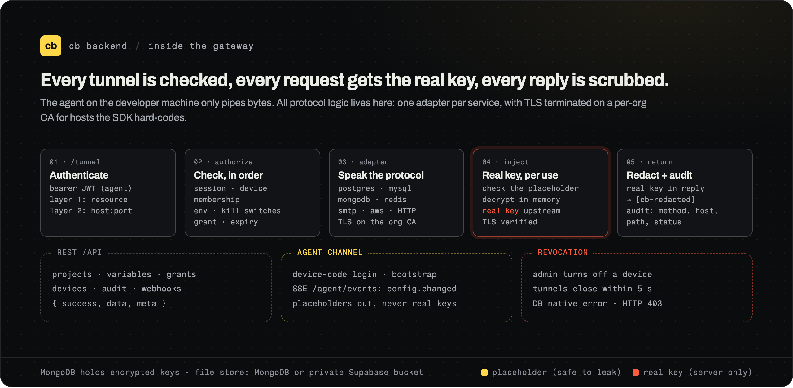
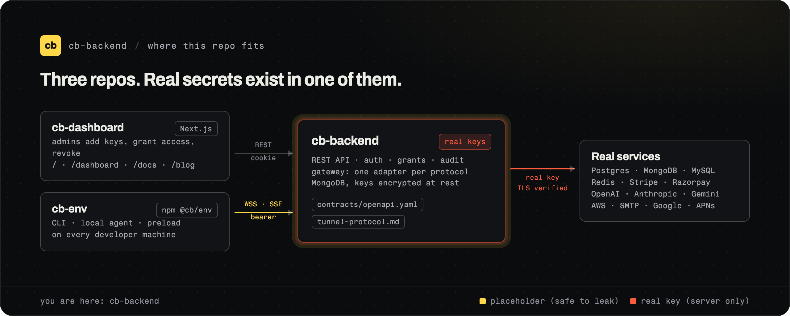

# cb-backend

<p align="center"></p>

The API and credential gateway for cb: the only part of cb that holds real secrets, so developers can run apps against real services without ever seeing a credential.

**Documentation:** the cb dashboard serves the docs at `/docs`; their source is in
[`content/docs/`](https://github.com/gdhyani/cb-dashboard/tree/main/content/docs) of gdhyani/cb-dashboard.

## How it works

<p align="center"></p>

- **REST API** for the dashboard and the CLI: projects, variables, grants, devices, audit, webhooks.
- **Gateway** (`/tunnel`): the agent on a developer machine only pipes bytes; every protocol adapter, TLS termination for hard-coded SDK hosts, key injection and response redaction live here.
- **Keys** are envelope-encrypted at rest (AES-256-GCM) and decrypted per use, never logged and never returned by any endpoint.

<p align="center"></p>

## Run

```bash
npm install
cp .env.example .env        # set MONGODB_URI, MASTER_KEY and SERVER_SECRET (openssl rand -base64 32)
npm run dev                 # nodemon, http://localhost:4200
curl localhost:4200/api/health
```

Uploaded key files and CA certificates are stored encrypted in MongoDB by default. To keep them in a private
Supabase Storage bucket instead, set `FILE_STORE=supabase`, `SUPABASE_URL` (https) and `SUPABASE_SECRET_KEY`
(optionally `SUPABASE_STORAGE_BUCKET`, default `cb-files`).

## Scripts

| Script | What it does |
|---|---|
| `npm run dev` | Dev server with reload (nodemon + tsx), loads `.env` |
| `npm run build` / `npm start` | Compile to `dist/` / run the compiled server |
| `npm test` | Unit + integration tests (in-memory MongoDB) |
| `npm run typecheck` / `npm run lint` | TypeScript / Biome |
| `npm run migrate:file-store [-- --apply]` | Move inline key files and CA certificates into the file store (dry run without `--apply`) |
| `npm run migrate:unified-variables [-- --apply]` | One-time move of older resources to Unified Variables (dry run without `--apply`) |

## Test services

`docker-compose.test.yml` starts password-protected Redis, PostgreSQL, MySQL (plain and TLS-only), an SMTP
server and S3-compatible storage for gateway tests. No passwords live in the file; export them first:

```bash
export CB_TEST_DB_PASSWORD=… CB_TEST_REDIS_PASSWORD=…
docker compose -f docker-compose.test.yml up -d --wait
```

## API conventions

Every REST response uses one envelope — `{ success: true, data, meta: { correlationId, pagination? } }` —
and every error one shape — `{ success: false, error: { code, message, statusCode, details?, correlationId } }`.
Send `x-correlation-id` to trace a flow through the logs.

## Contributing

Contributions are welcome. Read [CONTRIBUTING.md](CONTRIBUTING.md) before opening a pull request, and report
vulnerabilities privately as described in [SECURITY.md](SECURITY.md).

## License

Licensed under the [Apache License 2.0](LICENSE). See [NOTICE](NOTICE).
